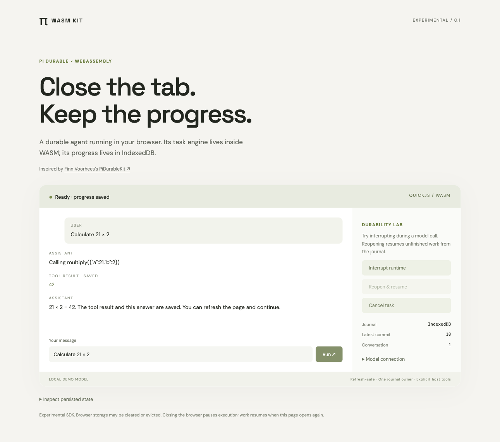

# Pi WASM Kit

**Pi Durable inside WebAssembly. Browser and Node.js hosts.**

Inspired by [Finn Voorhees’s PiDurableKit](https://github.com/finnvoor/PiDurableKit), which embeds Pi Durable in Apple apps with native capability bridges. Pi WASM Kit explores the same idea using QuickJS compiled to WebAssembly, with a TypeScript host API. This is an independent project, not an official port or an endorsed project.

[](https://github.com/leepokai/pi-wasm-kit/actions/workflows/ci.yml)



The **actual upstream Pi Durable engine** runs inside QuickJS WASM. The host supplies a model transport, an exclusive durable journal, and explicitly granted tools. Stop the process or terminate the Worker, reopen the same journal, and Pi resumes unfinished tasks from committed checkpoints.

**Experimental, v0.1.** Browser and Node are tested. Native Android/iOS, standalone WASI, and PostgreSQL execution are not implemented. A mobile Chromium viewport test is not an Android device test.

## Try it

Requires Node.js 22.19+ and a modern browser with IndexedDB and Web Locks (HTTPS or localhost).

```sh
git clone https://github.com/leepokai/pi-wasm-kit.git
cd pi-wasm-kit
npm ci
npm run build
npm run dev
```

Open the local URL. The demo uses a **deterministic local model**, not an LLM: every prompt demonstrates multiplying 21 by 2, with delayed model responses so you can interrupt it. The Pi engine, tool execution, WebAssembly, storage, and recovery are real.

1. Click **Run**.
2. While running, click **Interrupt runtime**. This actually terminates the Worker.
3. Click **Reopen & resume**. The existing journal is reopened.
4. Refresh the page. The saved conversation remains.

Optionally enter an OpenAI Chat Completions-compatible endpoint and model in **Model connection**, then interrupt and reopen. The endpoint must allow your origin through CORS. Use your own authenticated backend proxy; this demo has no login and does not store API keys. The endpoint and model selection are retained in localStorage so refreshing uses the same transport.

## Node example with a real model

```sh
PI_MODEL=your-model PI_API_KEY=your-key \
PI_BASE_URL=https://your-compatible-provider.example/v1 \
node examples/node/chat.mjs 'Hello from WASM'
```

`PI_BASE_URL` defaults to `https://api.openai.com/v1`. Credentials stay in the host transport and are not passed to the WASM guest. Journals contain prompts, model responses, tool arguments/results and application state; handle them as sensitive data.

## Use the SDK

Build a package with `npm pack`, then install the generated `.tgz` into your application. The GitHub release also contains the tarball. **This package has not been published to the npm registry.**

```ts
import { PiWasmAgent } from 'pi-wasm-kit';
import { openNodeJournal } from 'pi-wasm-kit/node';
import { openAICompatible } from 'pi-wasm-kit/openai';

const agent = await PiWasmAgent.open({
  journal: await openNodeJournal('./agent.jsonl'),
  model: openAICompatible({
    baseURL: process.env.PI_BASE_URL!,
    model: process.env.PI_MODEL!,
    apiKey: process.env.PI_API_KEY,
  }),
  tools: [{
    name: 'multiply',
    description: 'Multiply two numbers',
    parameters: {
      type: 'object',
      properties: { a: { type: 'number' }, b: { type: 'number' } },
      required: ['a', 'b'],
    },
    replay: 'safe', // Only for operations safe to repeat after interruption.
    execute: ({ a, b }, { signal, output, taskId }) => {
      signal.throwIfAborted();
      output('Calculating…');
      return String(Number(a) * Number(b));
    },
  }],
  onEvent(event) {
    if (event.type === 'events') console.log(event.events);
  },
});

try {
  const { id } = await agent.submit('Multiply 21 by 2', 'request-001');
  await agent.wait(id);
  console.log(await agent.view());
} finally {
  await agent.close();
}
```

In a browser Worker, replace `openNodeJournal` with `openBrowserJournal` from `pi-wasm-kit/browser`. Use a bundler such as Vite to serve the QuickJS WASM assets. The included demo shows the complete Worker bridge. Do not run CPU-bound guest code on the UI thread.

`model` can be any host function returning a Pi `AssistantMessage`. Its third argument accepts Pi `AssistantMessageEvent` values for incremental text, thinking and tool-call updates. The supplied HTTP adapter currently **buffers Chat Completions responses**; use a streaming `ModelHandler` for token-level events. The final message is returned from the handler; the bridge emits its terminal event.

## What is preserved from PiDurableKit?

The goal is to retain Pi’s capabilities rather than replace its scheduler with a simplified loop. See the [feature matrix](docs/features.md) for exact boundaries.

| Capability | Available here |
| --- | --- |
| Durable conversations and interrupted-run recovery | Upstream Pi + persisted journal |
| Input deduplication, steering, follow-ups | `submit`, `submitDraft`, `whenBusy` |
| Configuration, reset, fork and compaction | First-class host methods |
| Host tools, schema validation, progress and cancellation | JSON bridge, explicit host capabilities |
| Safe/unsafe tool replay | Upstream Pi policy, safe requires opt-in |
| Events, usage, task inspection and graph | `onEvent`, `watch`, `view`, `inspect`, `taskGraph` |
| JS extensions, tools, prompt sections, hooks and wrappers | CommonJS extension sources inside WASM |
| Documents, transactions, custom/child tasks and subagents | Upstream API inside extensions and `evaluate` |
| Apple Keychain, OAuth helpers, native filesystem/shell | Host integration required; not bundled |
| Android / iOS app integration | WebView integration is a possible next step; not device-tested |

## Extensions and advanced Pi APIs

Install a CommonJS source string at open time. Supported `require` names are `@earendil-works/pi-durable`, `@earendil-works/pi-ai` (**Type only**) and `@earendil-works/chord/context`.

```ts
const agent = await PiWasmAgent.open({
  journal,
  model,
  extensions: [counterExtensionSource],
});
```

See [the counter extension](examples/extensions/counter.cjs): a tool, prompt section, wrapper, transactionally deduplicated document mutation, and custom durable task. Definitions must be installed again on recovery; the journal stores task kinds and checkpoints, **not executable source code**. `install(source)` and `uninstall(name)` change the live registry.

For advanced integration, `evaluate(source, args, conversationId?)` runs a trusted async function body inside WASM. It receives `pi`, `Type`, `harness`, `conversation`, `registry`, `context`, and JSON `args`. This exposes the upstream document, task, hook and transaction APIs without attempting to serialize functions across the boundary.

```ts
const taskId = await agent.evaluate<number>(`
  const task = registry.snapshot().task('example.double');
  return conversation.commit(tx => tx.createTask(task, args, {
    ownership: { kind: 'conversation' }
  }), context);
`, { value: 21 });
const result = await agent.waitForTask(taskId);
```

Extension source and `evaluate` are **trusted application code**, not a multitenant plugin security boundary. Extensions share one guest and its granted capabilities. Do not evaluate arbitrary user/model-generated code with powerful host tools. See [architecture and durability](docs/architecture.md) and the [API guide](docs/api.md).

## Validation

```sh
npm test                         # Real WASM integration tests + local HTTP transport
npx playwright install chromium
npm run build:demo               # Production browser bundle
npm run test:e2e                  # Production Worker termination, reload, exclusion
npm run typecheck
npm run test:package              # Install the tarball into a clean consumer
```

Tests use synthetic model responses and a local HTTP fixture. They do not require paid credentials or claim to validate a live provider’s service. CI repeats the suite on Linux. Recovery is at committed task boundaries, not a snapshot of a JavaScript stack or an in-flight HTTP connection.

## Credits and license

- **Inspired by [PiDurableKit](https://github.com/finnvoor/PiDurableKit), by [Finn Voorhees](https://github.com/finnvoor).** Its Apple embedding design motivated this WASM host adaptation. No PiDurableKit Swift implementation is copied.
- Powered by [Pi Durable, Pi AI and Chord](https://github.com/earendil-works/pi), by Earendil Works and contributors; the upstream MIT notice credits Mario Zechner.
- Executes JavaScript using [quickjs-emscripten](https://github.com/justjake/quickjs-emscripten) and [QuickJS](https://bellard.org/quickjs/).

This project is MIT licensed. See [LICENSE](LICENSE), [NOTICE](NOTICE), and [third-party notices](third-party/README.md). Builds include `dist/licenses` with the license texts for bundled dependencies. Upstream licenses remain applicable.
