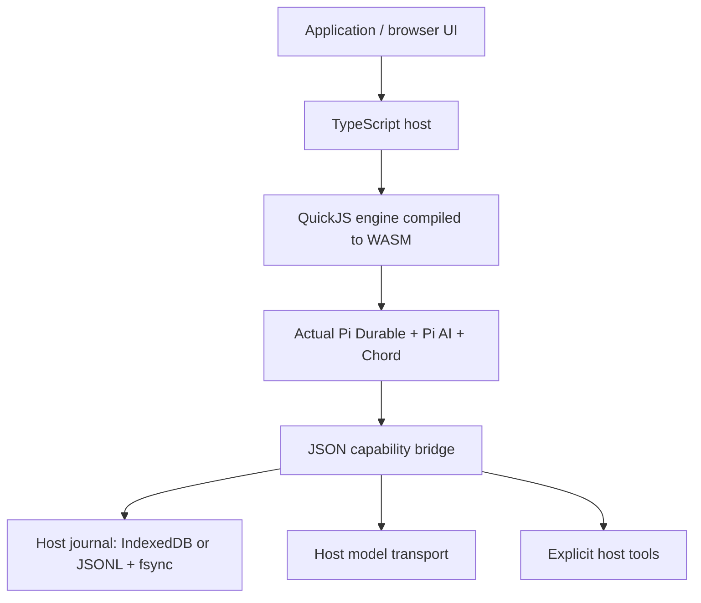

# Architecture and durability

The browser demo places the host and QuickJS inside a Web Worker. Terminating the Worker stops both. Node uses the same guest bundle and QuickJS build. Pi’s scheduler, tools policy, registry, documents, compaction and task transitions run inside the WASM JavaScript engine. Network and persistence run outside it. This is an Emscripten WASM module with JavaScript glue, not a standalone WASI component.

## Commit protocol

1. Pi submits a batch of `StorageWrite` records.
2. Upstream `MemoryStorage.prepareCommit` validates and detaches the batch without publishing it.
3. The bridge appends the complete batch and sequence to the host journal.
4. Only after durable append resolves is the prepared commit adopted by guest memory.
5. On reopen, committed batches are replayed in order, reconstructing Pi’s state and ID allocator before scheduling resumes.

The host commit event indicates persistence, not completion of an operation. For semantic state changes use Pi event batches or an awaited API call. Reopening reinstalls application extensions before the scheduler resumes.

## Persistence adapters

**Node:** local append-only JSONL, serialized writes, `fsync`, restrictive new-file permissions and an exclusive PID lock. An incomplete trailing line is removed on open; a malformed complete record fails closed. Confirmed dead local owners can be reclaimed; a separate exclusive reclaim guard serializes this path. An incomplete lock or abandoned reclaim guard requires operator inspection. PID reuse can conservatively block recovery. Do not place this journal on network storage or share it across machines/containers with different PID namespaces. This adapter is designed for local process-crash recovery, not a distributed database or a guarantee against every filesystem/hardware power-loss failure.

**Browser:** one IndexedDB transaction per batch with strict durability requested, and a Web Lock for the journal lifetime. A second tab fails instead of becoming another writer. Requires secure context APIs. Storage can still be cleared or evicted by the browser/user; request persistent storage in the embedding application where appropriate. Closing a tab stops execution. No service worker or server secretly keeps the workflow running.

All committed history is currently loaded into WASM memory on open. The journal grows without truncation; there is no storage compaction, encryption, cloud synchronization, multi-writer support or cross-device handoff protocol. **Conversation compaction reduces model context, not journal size.** Deployments with long histories need bounded retention/export and a more scalable adapter.

## Effects and replay

A tool is unsafe to replay by default. Pi records its intent before invocation. If interrupted after intent, an unsafe tool gets an interrupted receipt; a tool whose persisted and current declarations both say `replay: 'safe'` may rerun. Model calls may also repeat after interruption and may incur duplicate provider charges.

This is not exactly-once execution of external services. Use an external idempotency key derived from journal identity plus task ID or call ID. A tool that changes Pi document state can record the mutation and a deduplication record in one Pi transaction, as the counter example does.

Host tools and models receive cancellation signals. Hosts must cooperate by passing the signal to I/O and releasing resources. A tool that ignores cancellation can still complete its external effect after guest cancellation. `terminate()` stops the VM without admitting an abort into the journal; `abort()` records cancellation and waits for that scope to settle. `close()` is the normal graceful shutdown path and can wait for cooperative host work.

## Isolation and limits

Only JSON values cross the bridge. There is no ambient Node `process`, filesystem, shell or fetch in the guest. API credentials belong to the host model transport. Default guest memory is 64 MiB, stack is 1 MiB and each synchronous execution slice has a 1-second CPU budget. These are guest limits, not total application memory or workflow budgets. Use a Worker/process, OS limits and model/tool quotas for stronger isolation.

Trusted guest code can access the bridge and all capabilities granted to that runtime. Hooks and extensions share the same guest, and are not isolated from each other. Host tools must enforce their own authorization and input constraints. Upstream schema validation protects normal Pi invocations; it does not substitute for a host security boundary against hostile extension code.

The platform shim implements the subset needed by the bundled runtime: cancellation, timers, UUID/random bytes, UTF-8 conversion, and URL parsing. It is not a complete browser/Node environment. URL fields are parser snapshots; URL setters/searchParams and streaming TextDecoder are not implemented. Third-party extensions depending on unprovided web/Node APIs require a bridge or polyfill.

## Next platforms

A browser-capable Android WebView or iOS WKWebView could host the JavaScript glue and WASM. Native bindings would additionally need lifecycle, storage, credential and capability bridges plus real device tests. WAMR/Wasmtime cannot directly consume this package as a WASI component. A PostgreSQL adapter could persist commits externally; running an embedded agent natively inside PostgreSQL is a separate architecture, with database worker and transaction-lifetime constraints.
