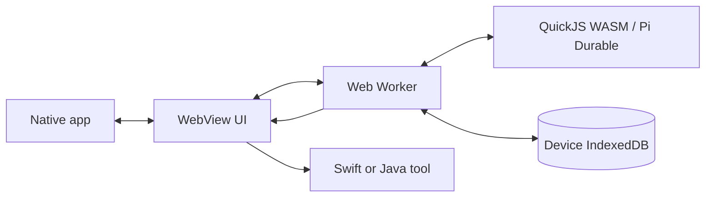

# Mobile runtime examples

[Swift / iOS](../examples/ios) and [Java / Android](../examples/android) embed the same production browser build. The bridge is deliberately small: a demo model asks the real Pi engine to multiply 21 × 2, and a native method returns 42. No model API credential is required. The demo allows a 10-second guest CPU slice for startup on slower WebViews; the SDK default remains one second. The guest runs in a Worker, which the host can terminate independently.



The development server **only serves assets**. Pi execution and the durable IndexedDB journal are inside the simulator/emulator/device. The examples do not bundle those assets for offline distribution and do not provide a native Swift/Kotlin SDK. Clearing application/WebView data deletes the journal.

## Run the shared assets

From the repository root, in a dedicated terminal:

```sh
npm ci
npm run build:demo
npm run preview -- --port 4173 --strictPort
```

iOS Simulator can reach the Mac's `http://127.0.0.1:4173`. Android uses `adb reverse tcp:4173 tcp:4173`. Loopback is a secure context for Web Locks; replacing it with a plain HTTP LAN address or `10.0.2.2` changes that property. Keep the origin and port stable to reopen the same journal. A physical iPhone needs an HTTPS asset origin reachable from the phone and matching changes to the navigation and bridge allowlists. These examples intentionally grant native capabilities only to the local demo origin.

## Native boundary

- iOS: `WKScriptMessageHandlerWithReply`, main-frame and exact-origin checks, persistent `WKWebsiteDataStore.default()`.
- Android: AndroidX `WebViewCompat.addWebMessageListener`, exact allowed origin, main-frame checks. No unrestricted `addJavascriptInterface`.
- Native tools validate the method and finite numeric arguments. This bridge grants multiplication only; adding filesystem, shell, or payment tools requires explicit application policy.
- Model transport remains in the Worker in these examples. Use a backend proxy or a native host transport for credentials. Do not put long-lived secrets in delivered JavaScript.
- The example's model responses are deterministic; only the runtime, tool bridge and persistence are real.

## iOS 26 continued processing

`BGContinuedProcessingTask` was introduced in iOS 26. It lets a user-started operation request time to continue after leaving the app. It is **not** an unlimited background daemon and does not independently make a WKWebView's renderer run forever.

The example uses a `.fail` request, one active task, a permitted identifier, and progress based on three actual stages: admitted input, native tool result, settled submission. The app reports denied requests and keeps the ordinary foreground Run action available. On success it completes once. On expiration or system cancellation it records an intent in a synchronously written atomic file, stops the WebView, and completes unsuccessfully. On the next open it pauses the scheduler, durably cancels the root conversation, then resumes the scheduler. The marker is cleared only after cancellation succeeds. Storage failures are reported; a failed cancellation-marker write cannot guarantee suppression of replay. Force-kill can happen without an expiration callback: unfinished work then follows normal durable recovery.

This learns from PiDurableKit's host/runtime separation; it does **not** copy a PiDurableKit background implementation. PiDurableKit uses JavaScriptCore. Here the WebView and its renderer have additional platform lifecycle constraints.

### Validation boundary

Automated checks exercise actual WASM and native tools on iOS Simulator and Android Emulator, including completed-result persistence and interrupted-work recovery across app/process relaunch. Swift tests cover expiration ordering and exactly-once completion; a WASM integration test proves persisted work is cancelled before a model can replay.

**Actual background time grants and sustained WKWebView execution on a locked/backgrounded physical iPhone have not been verified.** Simulator tests cannot establish that behavior. Before shipping, run on a signed physical iOS 26+ device:

1. Request background time while the app is visible; observe a grant or explicit rejection.
2. Leave the app and lock the device; observe whether progress and completion continue.
3. Cancel through the system's task UI; reopen and verify the cancelled work does not replay.
4. Repeat with process termination, denied scheduling, network loss and device power constraints.

The deterministic demo finishes quickly. Use a longer representative workload for these device checks. Android's example has no background service or WorkManager adapter; it resumes when the app runs again.

## References

- [Apple: Performing long-running tasks on iOS and iPadOS](https://developer.apple.com/documentation/backgroundtasks/performing-long-running-tasks-on-ios-and-ipados)
- [Apple: BGContinuedProcessingTask](https://developer.apple.com/documentation/backgroundtasks/bgcontinuedprocessingtask)
- [Android: WebViewCompat](https://developer.android.com/reference/androidx/webkit/WebViewCompat)
- [Android: Native bridge security](https://developer.android.com/privacy-and-security/risks/insecure-webview-native-bridges)
- [PiDurableKit, by Finn Voorhees](https://github.com/finnvoor/PiDurableKit)
